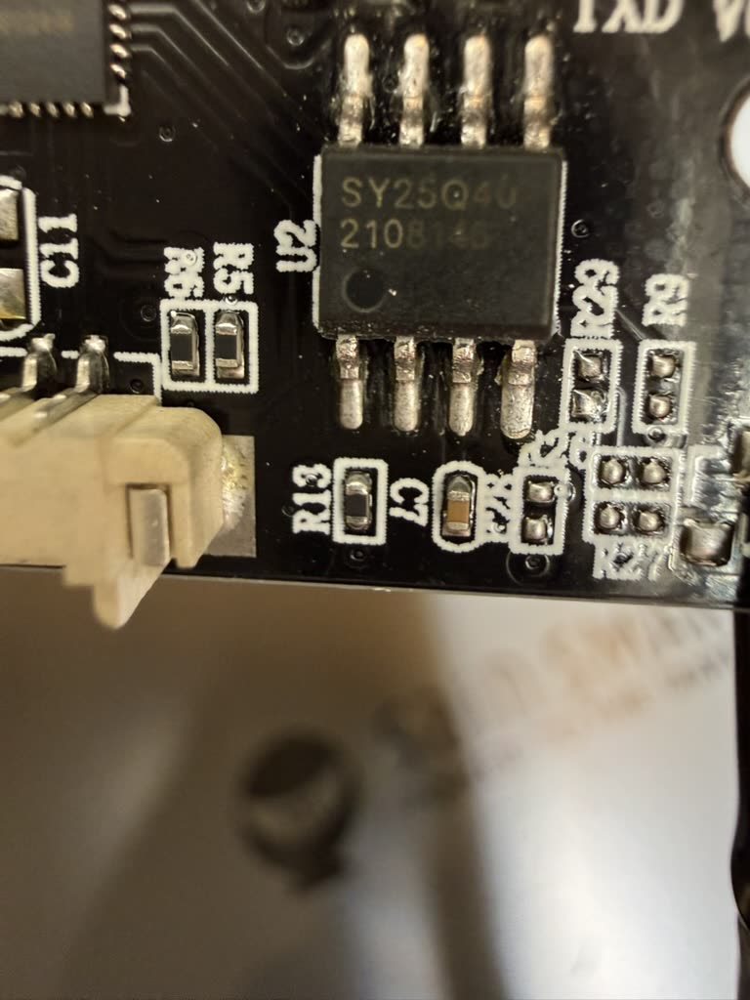

# flashcard-toy-revoice

Replace every sound in a "talking flash cards" toy with your own voice: in our
case all 224 words in Swiss German, recorded by a parent for their kid.

(Ours had 224 words. [This 510-word version](https://a.co/d/0aT8sqor) looks like a bigger sibling, and the same approach likely applies.)

The toy reads a card and plays a sound from a 512 KB SPI flash chip, driven by a
JieLi audio MCU. This repo has everything we learned and every tool we used: dump
the chip with a Raspberry Pi Pico, decode the filesystem and audio, record and
slice new words, encode them in JieLi's F1A format, build a new image, and write it.



## How it works, in one paragraph

The flash holds a flat directory of 32-byte entries (name, offset, length, two
CRC-16 checksums) followed by the audio data. Card *N* plays `NNN.f1a`. Replacing a
sound means writing new F1A data into free space and pointing that file's entry at
it. The audio has to go through Microsoft's WMA encoder and then JieLi's F1A encoder,
which only fully works on Windows. Writing in-circuit fights the toy's own MCU for
the SPI bus, so the chip comes off the board for one clean write and goes back on.

## Docs

| | |
|---|---|
| [docs/hardware.md](docs/hardware.md) | The toy, its boards, the flash chip |
| [docs/wiring.md](docs/wiring.md) | Pico ↔ chip pinout, clip vs. socket |
| [docs/filesystem.md](docs/filesystem.md) | The on-flash filesystem, byte by byte |
| [docs/audio-format.md](docs/audio-format.md) | F1A, the encoder chain, bitrate vs. space |
| [docs/safer-encoding.md](docs/safer-encoding.md) | Running the vendor tools with less risk: Windows only for WMA, the rest in Wine |
| [docs/recording.md](docs/recording.md) | Recording, slicing and reviewing your words |
| [docs/flashing.md](docs/flashing.md) | Backup, build, write, verify, and why in-circuit fails |
| [docs/soldering.md](docs/soldering.md) | Shopping list, chip removal and resoldering |
| [docs/barcode.md](docs/barcode.md) | Decoding the card codes, making custom cards |

## Tools

All host tools are Python 3 (no dependencies besides `mpremote`) plus `ffmpeg` for audio.

| Tool | Does |
|---|---|
| `tools/check_connection.py` | Read-only check of the Pico ↔ chip connection. Run it every time you seat the clip |
| `tools/dump.py` | Back up the whole chip (multiple reads, compared or OR-merged) |
| `tools/merge_reads.py` | OR-merge imperfect dumps from a flaky connection |
| `tools/fs_list.py` | List the filesystem in a dump, extract all files |
| `tools/slice.py` | Split one recording into a clean 16 kHz WAV per word |
| `tools/trim_start.sh` | Cut a click off the start of a word |
| `tools/compare.sh` | Play original → new for a list of cards (macOS) |
| `windows/wav2wma.bat` | WAV → WMA only, the one step that needs Windows |
| `tools/wine_f1a.sh` | WMA → F1A plus a decoded check WAV, with the JieLi tools under Wine |
| `windows/encode.bat` | WAV → WMA → F1A, all on Windows |
| `windows/decode.bat` | F1A → WAV (on Windows) |
| `tools/card_code.py` | Card number ↔ printed card code |
| `tools/build_image.py` | Build a new image from a backup plus your F1A files |
| `tools/write_flash.py` | Write only the changed sectors, verified, directory last |
| `tools/pico/` | The MicroPython code the tools run on the Pico |

## Quick start

```sh
pip install -r requirements.txt
python3 tools/check_connection.py
python3 tools/dump.py backup.bin                                       # keep this file safe
python3 tools/slice.py colors.m4a voice --tempo 1.18 0103_purple 0104_brown ...
#   ... windows/encode.bat voice 12 on a Windows PC, bring voice\f1a back ...
python3 tools/build_image.py backup.bin voice/f1a new.bin
python3 tools/write_flash.py backup.bin new.bin --check-only
python3 tools/write_flash.py backup.bin new.bin
```

## What you need

- A Raspberry Pi Pico (we used a Pico 2 W) with MicroPython, a SOIC-8 test clip, jumpers
- A Windows PC (for the WMA step only)
- `ffmpeg` and Python 3 on your computer
- To write reliably: a hot air station or Chip Quik, and a soldering iron ([docs/soldering.md](docs/soldering.md))

## Not included, on purpose

- **No flash dumps and no original audio.** They're the toy maker's content. Make
  your own backup; you need it anyway.
- **No JieLi or Microsoft binaries.** Download
  [jieLi-cli-tools.zip](https://github.com/Jihao2048/jieli-audio-whitepaper/releases/download/v1.0.0/jieLi-cli-tools.zip)
  from [Jihao2048/jieli-audio-whitepaper](https://github.com/Jihao2048/jieli-audio-whitepaper),
  which made this project possible.
- **No recordings** of our voices.

## Status

Done and working: the toy speaks all 224 cards plus its "insert card", "go to rest"
and "battery low" prompts in our voice. The card code is decoded too, see
[docs/barcode.md](docs/barcode.md).

## License

MIT. See [LICENSE](LICENSE). Use at your own risk: keep your first backup, and
don't feed the chip 5 V.
