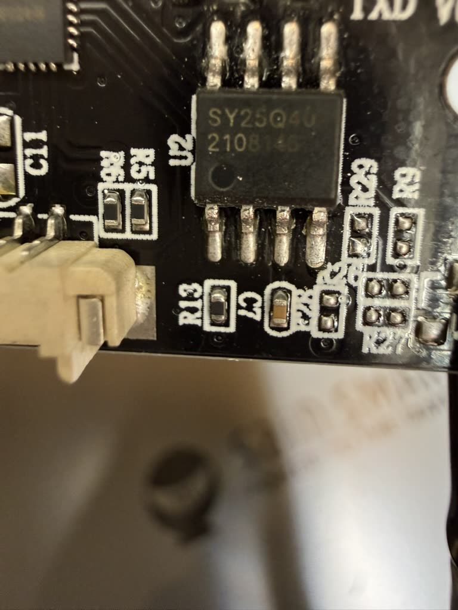
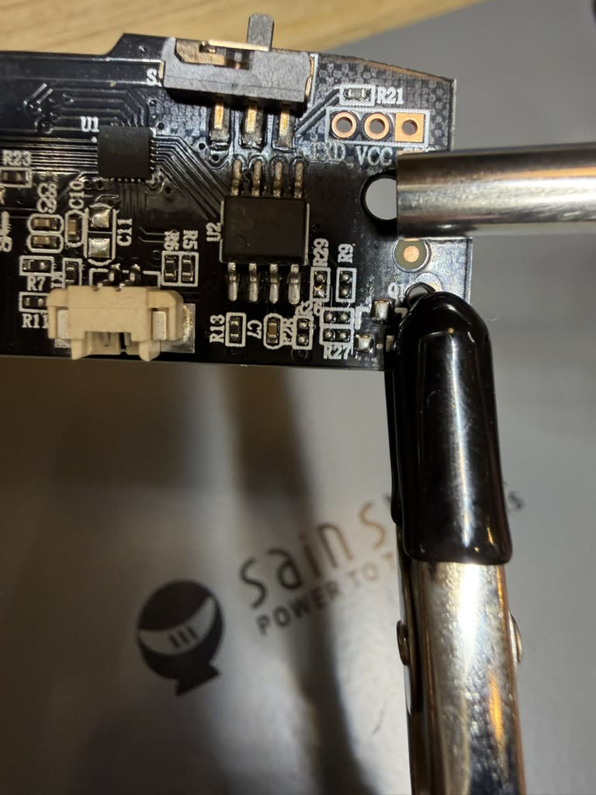

# The toy and its hardware

## The toy

A common "talking flash cards" toy for small children: a plastic reader with a slot
and a speaker, plus a deck of 112 double-sided cardboard cards (224 words in 14
categories: animals, vehicles, colors, foods, ...). Push a card through the slot and
the toy says the word printed on it. Ours came with English audio. They're sold
under many brand names. Look for a slot on top and a strip of holes or black marks
along the bottom edge of each card.

`data/cards.csv` lists every sound we found (card number, category, word).

## Boards

Two boards inside:

- **Main board**: the JieLi audio MCU (U1), the SPI flash with all the audio (U2),
  slide switch (S1), micro-USB (charging), JST connectors for battery and speaker,
  and three pads labelled **TXD / VCC / GND** (a debug UART, not a programming port).
- **Sensor board** (`ZP-BBC-N9 V1.1` on ours): the IR LEDs and sensors that read the
  card's code. See [barcode.md](barcode.md).

## The flash chip (U2)

| | |
|---|---|
| Marking | `SY25Q40P` |
| Actually | Puya **P25Q40H** (JEDEC ID `85 60 13`) |
| Size | 4 Mbit = **512 KB** (128 sectors of 4 KB) |
| Supply | 2.7–3.6 V (**not** 5 V tolerant) |
| Package | SOIC-8, **narrow (150 mil)** |
| Commands used | `9F` read ID, `03` read, `06` write enable, `20` 4 KB sector erase (≈ 500 ms), `02` page program (256 B, ≈ 10 ms) |

Pin 1 is marked with a round dot on the package. See [wiring.md](wiring.md) for the pinout.

## The MCU (U1) and why it matters

U1 is a JieLi audio chip. It reads the flash over the same four SPI wires we use,
and it **actively drives those lines**. That is the single most important fact for
anyone trying to reprogram this toy in-circuit. See
[flashing.md](flashing.md#why-in-circuit-writing-is-unreliable).

## The audio codec

The sounds are stored in JieLi's own compressed **F1A** format. The vendor's
encoder takes a WMA file as its input. See
[audio-format.md](audio-format.md).
