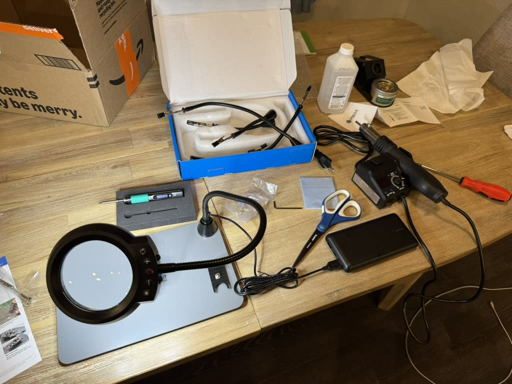
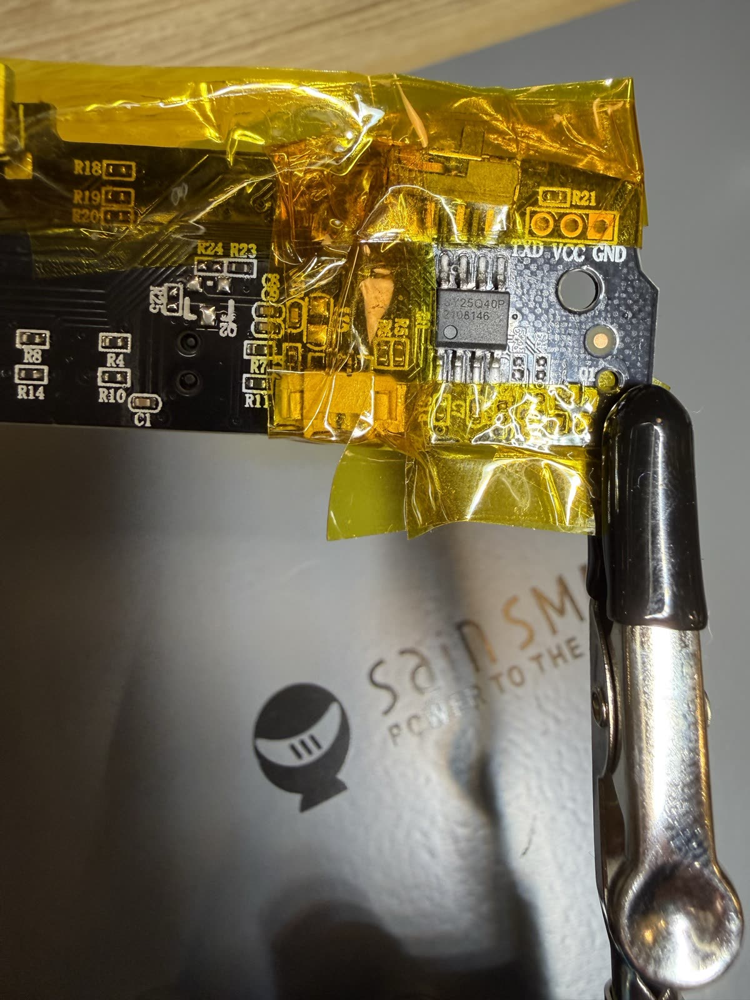
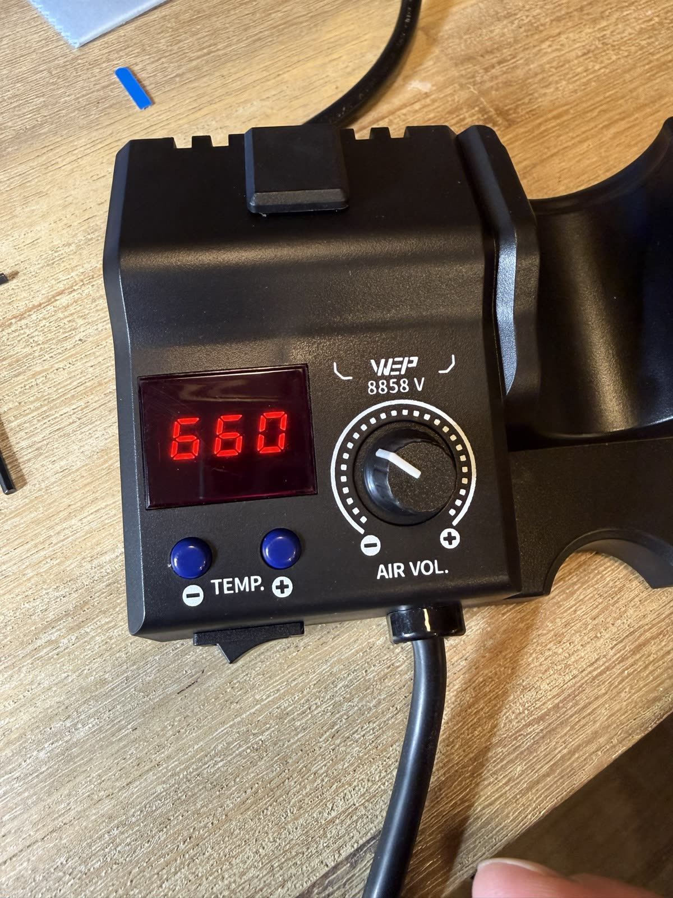
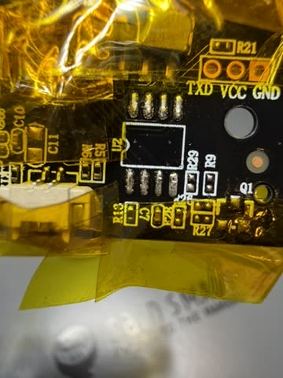
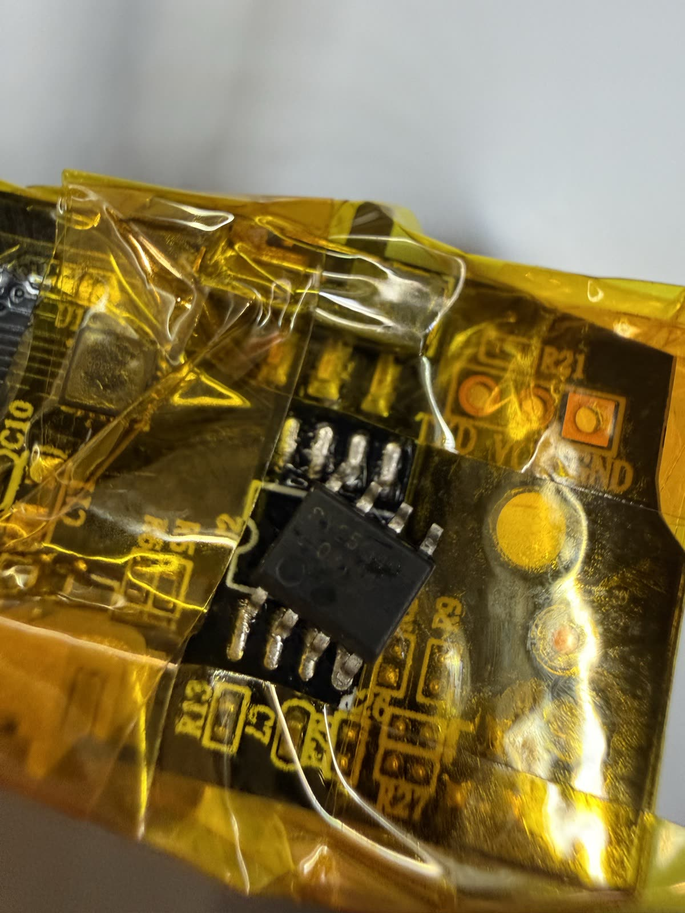
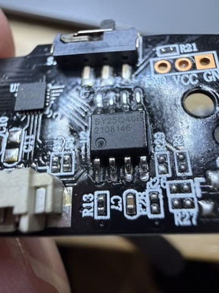
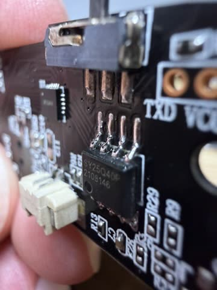

# Taking the chip off and putting it back

Last soldered in 2003? So had we. This worked on the first evening.

## Shopping list (≈ $150, all reusable)

| Item | Why |
|---|---|
| Temperature-controlled iron. We used a **Pinecil V2** (SKU "Pinecil BB2", 18–88 W) on a 96 W USB-C laptop charger | Phone chargers and most power banks can't supply 20 V |
| Hot air rework station. Ours: WEP 8858 | Takes the chip off in under a minute |
| No-clean flux paste in a syringe ("559" type) | Makes solder flow; apply with a toothpick if there's no needle |
| 63/37 rosin-core solder, 0.6 mm | Leaded melts lower and flows easier |
| Desoldering braid (≈ 2.5 mm) | Cleaning pads |
| Kapton (polyimide) heat tape, 10 mm | Shielding plastic parts from hot air |
| ESD tweezers, straight and angled | Lifting and placing the chip |
| Iron stand with brass wool | Safety, tip cleaning |
| Helping hands / PCB holder with magnifier and light | Hold the board flat |
| Isopropyl alcohol (≥ 90%) | Cleaning off flux |
| Optional: Chip Quik SMD1 removal alloy | Alternative to hot air, using the iron only |

## Removing the chip (hot air)

1. Unplug battery and speaker. Take the board out of the case.
2. Photograph the chip and note which corner the **pin-1 dot** is in.
3. Tape off everything plastic and everything small near the chip: the slide
   switch, the white JST connector (2–3 layers), the MCU. Leave about 1 mm of bare
   board beyond the chip's legs.
4. Clamp the board by its far end. Keep the clip's rubber sleeve away from the chip.
5. Thin line of flux along both rows of legs.
6. Hot air: **660 °F / 350 °C, low airflow** (~35% on our dial), smallest round nozzle.
7. Warm up for 10 s with wide circles, then small circles 1 cm above the chip, both
   rows evenly.
8. From about 30 s, nudge the chip end with angled tweezers every few seconds.
   **Don't pry.** When it slides freely, lift it straight up.
9. Put the hot air handle back in its cradle and leave the station plugged in. It
   cools itself down.

## Writing it

Clip the loose chip, wire WP and HOLD (see [wiring.md](wiring.md)), and follow
[flashing.md](flashing.md). Off-board, the connection check said `GOOD` with 0%
dropped bits on the first try.

## Putting it back

Hot-air reflow (flux, place chip, heat until the solder melts) looked fine but the
chip came off as soon as we handled the board. The solder hadn't fully melted.

What worked, without adding any solder (the pads still had enough):

1. Iron at **340 °C** (the Pinecil shows °C by default). The stock conical tip is fine.
2. Peel off any tape that's in the way.
3. Thin flux on all 8 pads.
4. Place the chip, **dot in the same corner as before**, legs centred on the pads.
5. Hold the chip down with tweezers on its top.
6. Touch the iron to one corner leg, where the leg meets the pad, for about 2 s.
7. Check alignment. If it's off, reheat that leg and nudge.
8. Touch the diagonally opposite corner leg for 2 s, then each of the other six.
9. Push the chip gently with the tweezers. It must not move.
10. Clean off the flux with alcohol. Look at both rows at a low angle: every leg
    should have solder running down onto its pad, with no bridges between legs.

Then reconnect battery and speaker, switch on, insert a card.
