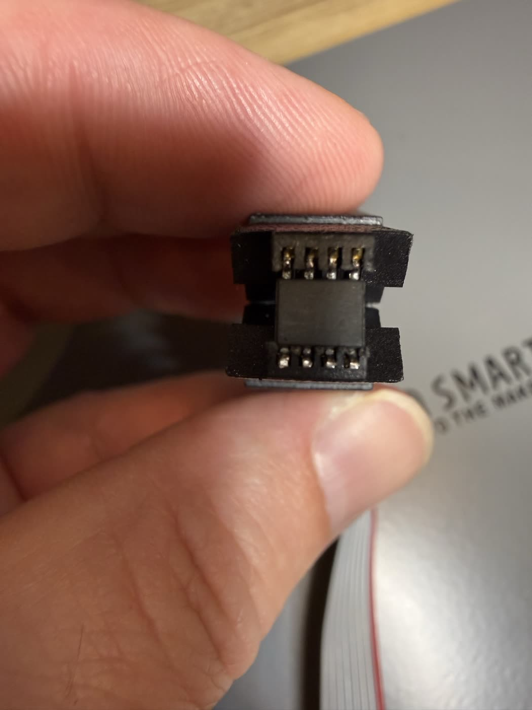
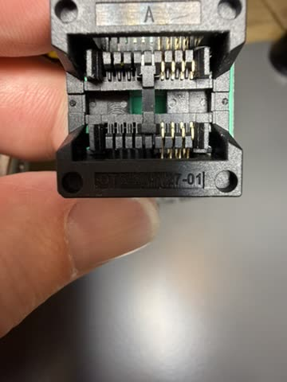

# Wiring: Raspberry Pi Pico to the flash chip

We used a **Raspberry Pi Pico 2 W** running MicroPython, a SOIC-8 test clip with
a ribbon cable, and Dupont jumpers. Any RP2040/RP2350 Pico works: the tools
bit-bang SPI on plain GPIOs, so nothing depends on hardware SPI.

**Use 3.3 V only.** Many cheap CH341A programmers put 5 V on the chip, which this
chip isn't rated for.

## Pin map

| Chip pin | Signal | Pico GPIO | Pico physical pin | Our jumper colour |
|---|---|---|---|---|
| 1 | CS (chip select) | GP17 | 22 | brown |
| 2 | DO (data out, "MISO") | GP16 | 21 | red |
| 3 | WP (write protect) | GP20 | 26 | orange |
| 4 | GND | GND | 23 | yellow |
| 5 | DI (data in, "MOSI") | GP19 | 25 | green |
| 6 | CLK | GP18 | 24 | blue |
| 7 | HOLD | GP21 | 27 | black |
| 8 | VCC | 3V3(OUT) | 36 | purple |

```
         ┌───────────┐
  CS  1 ─┤ ●         ├─ 8  VCC
  DO  2 ─┤  SY25Q40P ├─ 7  HOLD
  WP  3 ─┤           ├─ 6  CLK
  GND 4 ─┤           ├─ 5  DI
         └───────────┘   (top view, dot = pin 1)
```

The clip's red ribbon wire is pin 1. Line it up with the dot on the chip. Don't
confuse it with the jumper colours above: on our setup the clip's red wire went to
the **brown** jumper.

## WP and HOLD

- **In-circuit** (chip still on the toy's board): the board already pulls WP and
  HOLD up. You can leave clip pins 3 and 7 unconnected.
- **Off-board** (loose chip in a clip): they **must** be held high, or the chip
  ignores writes (WP) or every command (HOLD). The Pico has only one 3V3 pin, so we
  wire them to GP20/GP21 and the tools drive those high (see `tools/pico/spi.py`).

DO has the Pico's internal pull-up enabled. On a bad contact, reads then come back
as 1s instead of floating garbage, but a dropped bit shows up as a 0. That one-way
error is what makes OR-merging reads work (see [flashing.md](flashing.md)).

## Clip vs. socket



Once the chip is off the board, the clip holds it well: press the chip in, legs
seated in each contact. Our ZIF test socket (from a CH341A kit) turned out to be for
**wide** SOIC (208/300 mil) bodies. The narrow chip just floats in it. Check that
the socket matches the chip width before relying on it.


